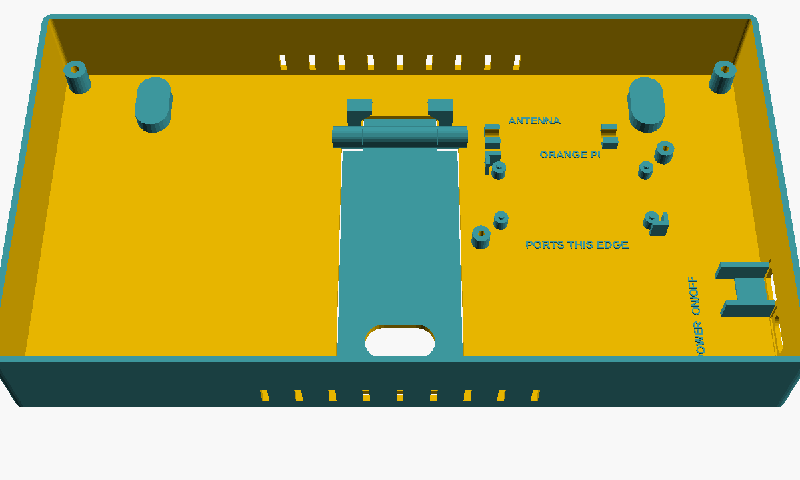

# Assembly guide

Every part has a labeled spot on the back tray, so you can check placement as you go.



You need: the printed back tray, front, end zones and 2 Pi clamps, plus everything in the [parts list](parts.md).
Set up the SD card first ([software setup](software-setup.md)) so you can test before closing it up.

## Wiring

```
USB charger ──► USB-C POWER socket ──► + (red) ──► ON/OFF switch ──► pigtail red  ──┐
                                   └─► − (black) ─────────────────► pigtail black ─┴─► Orange Pi power port (USB-C)

Orange Pi second USB-C ──► 90° USB-C to micro-USB OTG cable ──► screen "Touch" port   (screen power + touch)
Orange Pi mini-HDMI    ──► 90° FPC ribbon                  ──► screen HDMI
```

- Only the **+ (red)** wire goes through the switch. **− (black)** goes straight to the pigtail.
- Check which of the Orange Pi's two USB-C ports is **power** (it's marked on the board). The other one is for the
  screen.
- Solder or crimp the switch connections and cover them with heat-shrink.

> ⚠️ **The 2-wire snap-in USB-C socket only turns on from a USB-A charger with an A-to-C cable.** A USB-C to USB-C
> charger won't power it, because the socket lacks the 5.1 kΩ resistors that tell a USB-C charger to turn on. If you
> only have USB-C chargers, use a breakout board with 5.1 kΩ resistors instead (the wiring is the same). See
> [troubleshooting](troubleshooting.md#no-power).

## Steps

### 1. Orange Pi

1. Put the SD card in the Orange Pi.
2. Set it on its 4 pegs with the ports toward the **PORTS THIS EDGE** label.
3. Swing a clamp over each of the two clamp corners and screw it down with an M3 × 8 screw until snug. To lift the
   board out later, loosen the screws and swing the clamps aside.

### 2. Antenna

Plug the antenna into the Orange Pi and press its thick ends down into the two C-clips marked **ANTENNA**. Either end
can face the board.

### 3. Switch and power socket

1. Snap the switch into the **ON/OFF** hole and the USB-C socket into the **USB-C PWR** hole, both from outside.
2. Wire them as above and plug the pigtail into the Orange Pi's power port.

### 4. Screen

1. Lay the front face down on a soft towel.
2. Set the 7" screen face down in it, **ports toward the right end**.
3. Screw its 4 ears to the 4 posts with M3 × 8–10 screws.
4. Plug in the FPC ribbon (HDMI) and the USB-C to micro-USB cable (Touch port on the screen).

### 5. Test before closing

Plug in the charger and flip the switch. The scoreboard should come up (the first boot after setup takes 15–20
minutes). Tap the screen to check touch. If anything's wrong, see [troubleshooting](troubleshooting.md).

### 6. Close it up

1. Lay the front (with the screen) onto the tray, tucking the cables in.
2. Drive the 4 M3 × 20 screws in from the back, into the front's corner posts. Snug is enough.
3. Press the end zones in until they click.
4. Stick a thin rubber strip in the recess on the kickstand foot.

## Desk or wall

- **Desk:** pull the kickstand open by the finger slot near its foot. It stops at about 32° and leans the frame back
  about 22°.
- **Wall:** leave the kickstand folded (it clicks shut) and hang the frame on two screws 200 mm apart, using the
  keyholes. Screw heads up to 8.5 mm across fit.

## Getting inside later

Take out the 4 back screws and lift the front off with the screen still attached. Everything in the tray is then easy to
reach.
