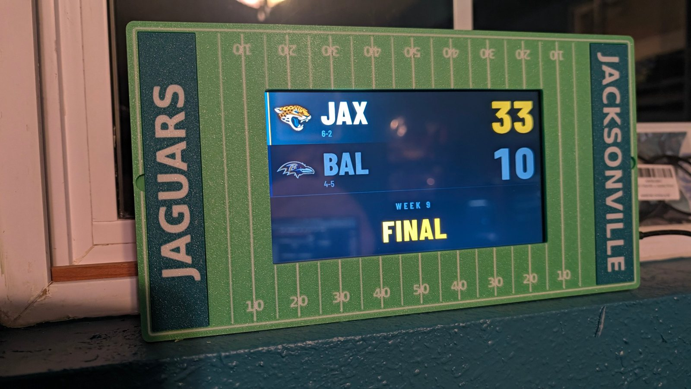
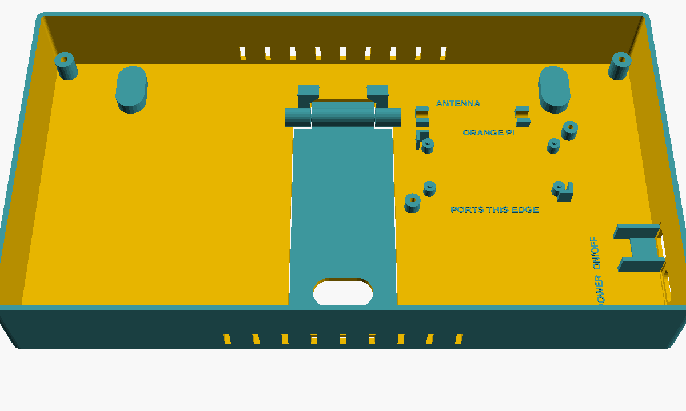

# Field frame (3D models)

A football-field frame for the scoreboard. It hangs on a wall from two keyholes or stands on a desk on its fold-out
kickstand. One back tray holds all the electronics. Each screen has its own field front that screws onto the tray from
behind, and the end zones are swappable snap-in inserts.



**Size:** 280 × 150 × 42 mm. **License:** [CC BY-NC-SA 4.0](LICENSE).

- **To print it:** [printing guide](../docs/printing.md)
- **To put it together:** [assembly guide](../docs/assembly.md)
- **To customize it without code:** [OpenSCAD customizers](openscad/README.md)

## What's here

| Path | What it is |
|---|---|
| `stl/` | every part, ready to print (STL, plus STEP for CAD apps and 3MF for two-color prints) |
| `stl/tests/` | small fit tests cut from the real parts |
| `field_frame.py` | the CadQuery source every STL is built from |
| `make_3mf.py` | packs the two-color parts into 3MF files |
| `check_report.txt` | the overlap and fit check from the last build |
| `openscad/` | customizers: end zones and back tray |

## The back tray: every part has a labeled spot



| Label on the tray | Part | Holder | Size block in `field_frame.py` |
|---|---|---|---|
| ORANGE PI / PORTS THIS EDGE | Orange Pi Zero 2W | 4 pedestals with pegs through its holes, corner guides, and 2 swivel clamps (M3 × 8) at the corners away from the microSD slot and antenna plug | `PI`, `PI_CLAMP` |
| ON/OFF | KCD11 2-pin rocker switch | 14 × 9 mm wall hole with side walls and a seat; wall thinned to 1.8 mm so it snaps in | `SWITCH` |
| USB-C PWR | 2-wire 5 V snap-in USB-C socket | 14.5 × 6.4 mm rounded hole; wall thinned to 1.8 mm | `JACK_PANEL_CUT` |
| ANTENNA | Orange Pi Wi-Fi antenna (63 mm stick) | two C-clips above the Orange Pi | `ANT` |
| — | 4 corner screw posts | M3 × 20 from the back into the front | `POS["post"]` |
| — | 2 keyholes, 200 mm apart | wall hanging (screw heads up to 8.5 mm) | `KEY` |
| — | kickstand | print-in-place leg; stops at 32° (about 22° lean back); clicks shut; finger slot near the foot | `KS` |

## Rebuilding the files

```bash
pip install cadquery trimesh manifold3d
python field_frame.py --check                          # overlap and fit report only
python field_frame.py                                  # rebuild everything
python field_frame.py --left HOME --right AWAY          # end zone text
python field_frame.py --left "" --right ""              # blank end zones
```

- **A part measures differently:** change its number in the `PI`, `SWITCH`, `JACK` or `SCREENS` block and re-run. The
  holders and wall holes move together because they use the same numbers.
- **Moving a part:** edit `POS`. The check flags anything that collides.
- **A new screen:** add a line to `SCREENS` (up to 20 mm thick). `mount_shift` centers the lit area in the window.

The build checks that no holder, label or part overlaps another, that both wall holes go all the way through, and that
neither screen nor its clamps hits anything.

## Measurements

**Measured:** Hosyond 7" (fits, lit area offset `mount_shift = (1.5, -3.5)`), Orange Pi 65 × 30 mm, KCD11 hole
14 × 9 mm, USB-C socket hole 14.5 × 6.4 mm, antenna 63 mm with a 40 mm cable.

**From spec sheets:** Orange Pi hole spacing 58 × 23 mm (the pegs are 2.4 mm in 2.75 mm holes, so small errors still
fit); Waveshare 7.9" (not yet built).
